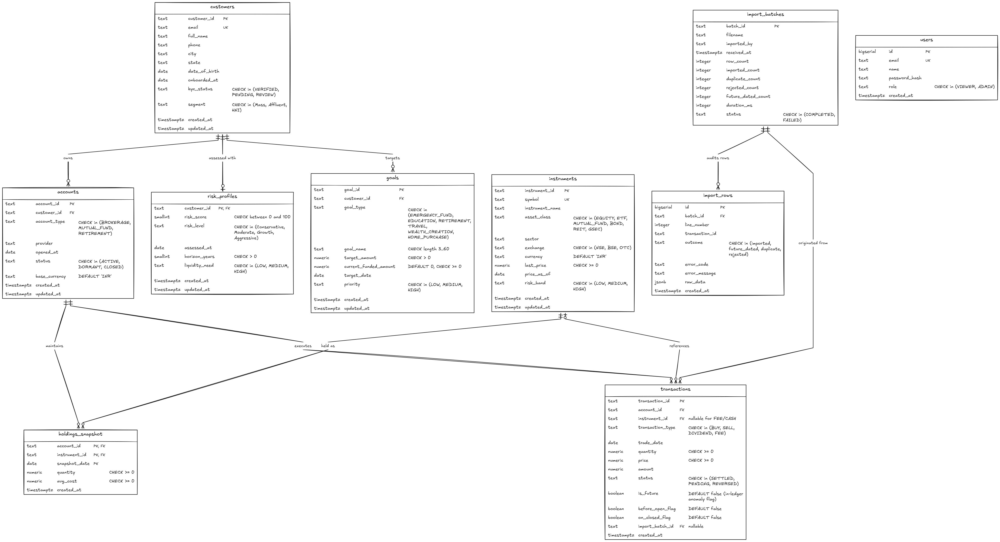
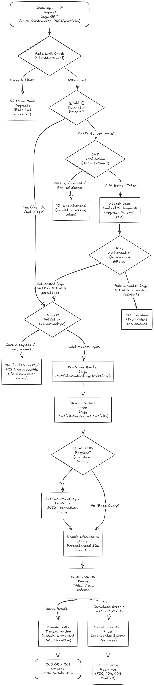
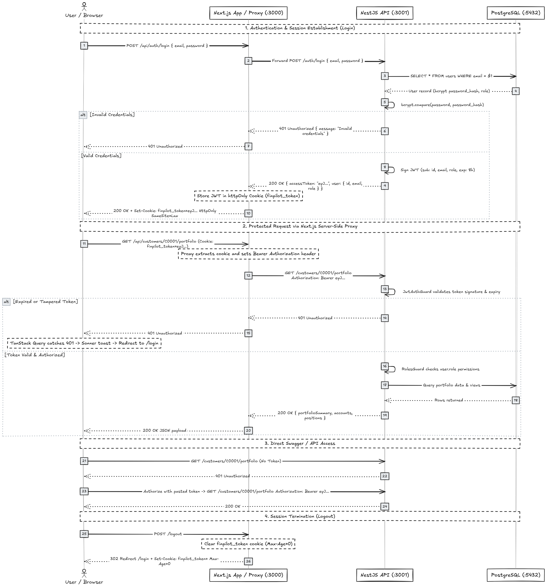
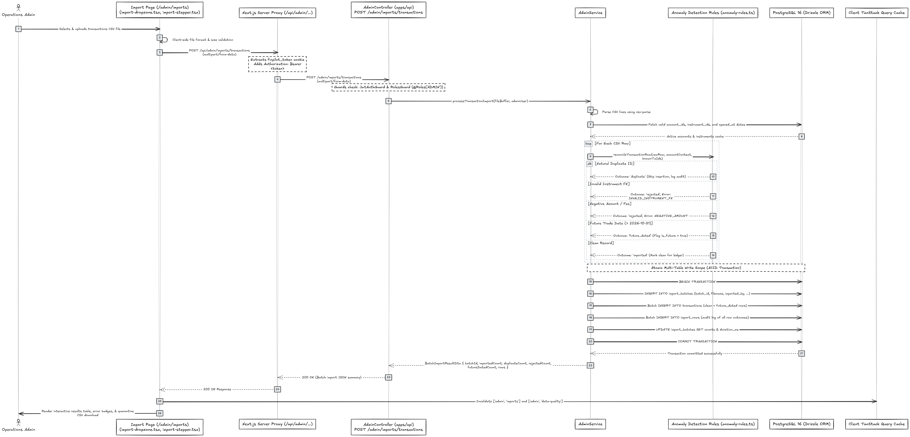

# FinPilot — Architecture & Engineering Documentation

This directory contains the architecture specifications, component breakdowns, data models, and request flow diagrams for FinPilot.

---

## Architecture Diagrams Index

| #   | Diagram                                                                                   | Image Preview                                            | Editable Source                                          | Description                                                                                          |
| --- | ----------------------------------------------------------------------------------------- | -------------------------------------------------------- | -------------------------------------------------------- | ---------------------------------------------------------------------------------------------------- |
| 1   | [Overall System Architecture](#1-overall-system-architecture)                             | [`system-architecture.png`](./system-architecture.png)   | [`system-architecture.mmd`](./system-architecture.mmd)   | High-level topology across browser, frontend proxy, shared contracts, NestJS API, and PostgreSQL     |
| 2   | [Database Entity Relationship Diagram (ERD)](#2-database-entity-relationship-diagram-erd) | [`database-erd.png`](./database-erd.png)                 | [`database-erd.mmd`](./database-erd.mmd)                 | Relational database schema, keys, foreign keys, cardinality, and constraints                         |
| 3   | [Backend Request Lifecycle](#3-backend-request-lifecycle)                                 | [`backend-request-flow.png`](./backend-request-flow.png) | [`backend-request-flow.mmd`](./backend-request-flow.mmd) | Ingress guards, throttling, JWT verification, role authorization, validation, ORM, and error filters |
| 4   | [Authentication & Authorization Flow](#4-authentication--authorization-flow)              | [`authentication-flow.png`](./authentication-flow.png)   | [`authentication-flow.mmd`](./authentication-flow.mmd)   | Login, bcrypt verification, JWT signing, httpOnly cookie proxying, Swagger bearer auth, and logout   |
| 5   | [Full-Stack Data Persistence Flow](#5-full-stack-data-persistence-flow)                   | [`full-stack-data-flow.png`](./full-stack-data-flow.png) | [`full-stack-data-flow.mmd`](./full-stack-data-flow.mmd) | End-to-end trace of CSV transaction ingestion, anomaly rules, ACID transaction, and audit logging    |

---

## 1. Overall System Architecture

### Overview

FinPilot is structured as a pnpm monorepo separating concern into:

1. **Client Tier:** Wealth operations and admin interface running in the user's browser with memory-only cache (TanStack Query).
2. **Frontend Tier (`apps/web` on port 3000):** Next.js 16 (React 19) App Router providing Partial Prerendering (PPR), server components, and a secure server-side API proxy route (`/api/[...path]`). The frontend application owns the user's session cookie and ensures client JavaScript never touches the raw JWT token.
3. **Shared Contracts Tier (`packages/shared`):** Single source of truth containing Zod validation schemas, TypeScript contract interfaces, and domain enums.
4. **Backend API Tier (`apps/api` on port 3001):** NestJS 12 REST API providing dependency-injected domain modules, rate limiting, JWT Bearer authentication, role-based authorization, and Drizzle ORM data access.
5. **Database Tier (`postgres` on port 5432):** PostgreSQL 16 container with versioned SQL migrations, relational constraints, GIN full-text search, and analytical views (`v_portfolio_positions`, `v_monthly_net_flows`).

### Diagram

> [!NOTE]
> Editable Mermaid source specification: [`system-architecture.mmd`](./system-architecture.mmd)

---

## 2. Database Entity Relationship Diagram (ERD)

### Overview

The database schema consists of 10 primary relational tables designed for operational integrity and financial reporting.

#### Rejected Alternative Note: `transaction_quarantine`

> [!IMPORTANT]
> A proposed `transaction_quarantine` table was considered during initial architecture planning but was **permanently rejected**.
> Instead of fracturing the financial ledger across multiple tables, FinPilot maintains a unified, immutable `transactions` table with an `is_future` boolean flag, while row-level validation rejections and duplicate skips are audited line-by-line in `import_rows`. The rejected table does not exist in migrations or schema definitions.

### Key Schema Elements:

1. **`customers`**: Master profile record. Indexed via GIN full-text search on `full_name || email || city || customer_id`.
2. **`instruments`**: Security master (stocks, ETFs, bonds, mutual funds, REITs, G-Secs) with latest valuation prices.
3. **`accounts`**: Investment accounts owned by customers (Brokerage, Mutual Fund, Retirement).
4. **`risk_profiles`**: Risk tolerance evaluation (Conservative, Moderate, Growth, Aggressive) with score 0–100.
5. **`goals`**: Financial goals with target amounts, funded balances, target dates, and priorities.
6. **`holdings_snapshot`**: End-of-day portfolio holdings. Composite primary key `(account_id, instrument_id, snapshot_date)` ensures idempotency and deduplication.
7. **`transactions`**: Unified trade ledger with anomaly flags (`is_future`, `before_open_flag`, `on_closed_flag`).
8. **`import_batches`**: Audit tracking for CSV ingestion operations.
9. **`import_rows`**: Line-by-line outcome record for all ingested, skipped, or rejected CSV rows with error codes.
10. **`users`**: System credentials with bcrypt password hashes and roles (`VIEWER`, `ADMIN`).

### Diagram

> [!NOTE]
> Editable Mermaid source specification: [`database-erd.mmd`](./database-erd.mmd)

---

## 3. Backend Request Lifecycle

### Overview

Every request sent to the NestJS API passes through a predictable, ordered series of pipeline stages:

1. **Rate Limiting:** `ThrottlerGuard` protects against denial-of-service and brute-force attacks (100 req/60s global; 5 req/60s on `/auth/login`).
2. **Public Route Check:** Endpoints decorated with `@Public()` (such as `/health` and `/auth/login`) bypass authentication checks.
3. **JWT Authentication:** `JwtAuthGuard` verifies the incoming `Authorization: Bearer <token>` header, decodes the signature, and attaches `req.user`.
4. **Role Authorization:** `RolesGuard` evaluates `@Roles(...)` metadata. If a user with role `VIEWER` attempts to access an `ADMIN` endpoint, a `403 Forbidden` response is returned immediately.
5. **Validation Pipe:** Incoming query parameters and request bodies are validated against class-validator and Zod schemas with automatic transformation and stripping of unwhitelisted fields.
6. **Service Layer & Persistence:** Controller methods invoke domain services. Services leverage Drizzle ORM parameterized queries or wrap multiple operations in a database transaction (`db.transaction`).
7. **Global Exception Filter:** Intercepts uncaught exceptions and database constraints to format RFC-compliant error envelopes.

### Diagram

> [!NOTE]
> Editable Mermaid source specification: [`backend-request-flow.mmd`](./backend-request-flow.mmd)

---

## 4. Authentication & Authorization Flow

### Overview

FinPilot implements a secure, defense-in-depth authentication model designed to eliminate XSS token leakage while providing seamless API access for tools like Swagger:

1. **Next.js Session Ownership:** The Next.js frontend application owns the user's session. After successful authentication at `/auth/login`, Next.js stores the token inside an `httpOnly`, `SameSite=Lax` cookie (`finpilot_token`). Client JavaScript cannot access this cookie.
2. **Server-Side API Proxy:** Browser requests to `/api/*` are intercepted by the Next.js server proxy. The proxy reads the `httpOnly` cookie and attaches it as an `Authorization: Bearer <jwt>` header when communicating with the NestJS API.
3. **Pure API Token Strategy:** The NestJS API accepts authentication **exclusively** via the `Authorization: Bearer <jwt>` header. It never sets or reads cookies. This ensures Swagger and external API clients can authenticate independently by pasting tokens into the Swagger UI Authorize dialog.
4. **Global 401 Interception:** If a cookie is cleared or a token expires mid-session, TanStack Query catches the 401 response, displays a user-friendly session expiry toast via Sonner, and redirects to `/login`.

### Diagram

> [!NOTE]
> Editable Mermaid source specification: [`authentication-flow.mmd`](./authentication-flow.mmd)

---

## 5. Full-Stack Data Persistence Flow

### Overview

This diagram traces a full end-to-end data lifecycle using the **Operations CSV Ingestion & Reconciliation** workflow as a representative case study:

1. **User Action & File Ingress:** An Operations Admin uploads a CSV file through the drag-and-drop dropzone on `/admin/imports`.
2. **Proxy Forwarding:** The Next.js server proxy forwards the multipart form-data along with the admin's Bearer token to the NestJS API.
3. **Role Enforcement:** The NestJS API verifies that the caller has the `ADMIN` role.
4. **Anomaly Detection Rules:** The service streams each row through `reconcileTransactionRow`:
   - Duplicate natural keys are identified and skipped.
   - Non-existent instrument FKs (`I9999`) or negative amounts are rejected with an explicit error code.
   - Future-dated trades are flagged with `is_future = true`.
5. **Atomic Multi-Table Write (ACID):** Valid rows, future-dated rows, and line-by-line audit records are inserted inside a single PostgreSQL transaction (`db.transaction`).
6. **Cache Invalidation & UI Update:** On response, the frontend invalidates stale TanStack Query caches, advances the 4-stage stepper, and displays the reconciliation breakdown with an option to download quarantined rows.

### Diagram

> [!NOTE]
> Editable Mermaid source specification: [`full-stack-data-flow.mmd`](./full-stack-data-flow.mmd)

---

## Exported Architecture Diagrams & Source Files

| # | Architecture Diagram | Exported Diagram (PNG) | Editable Source File (.mmd) |
|---|---|---|---|
| 1 | Overall System Topology | [`system-architecture.png`](./system-architecture.png) | [`system-architecture.mmd`](./system-architecture.mmd) |
| 2 | Database Entity Relationship Diagram (ERD) | [`database-erd.png`](./database-erd.png) | [`database-erd.mmd`](./database-erd.mmd) |
| 3 | Backend Request Pipeline & Ingress | [`backend-request-flow.png`](./backend-request-flow.png) | [`backend-request-flow.mmd`](./backend-request-flow.mmd) |
| 4 | Authentication & Authorization Lifecycle | [`authentication-flow.png`](./authentication-flow.png) | [`authentication-flow.mmd`](./authentication-flow.mmd) |
| 5 | Full-Stack Data Persistence & CSV Trace | [`full-stack-data-flow.png`](./full-stack-data-flow.png) | [`full-stack-data-flow.mmd`](./full-stack-data-flow.mmd) |
